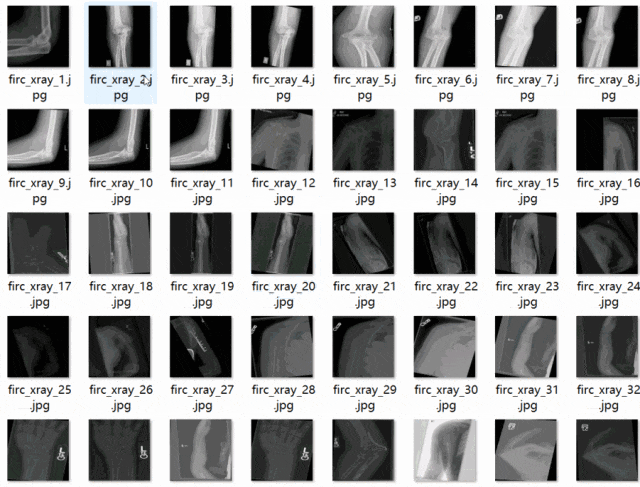
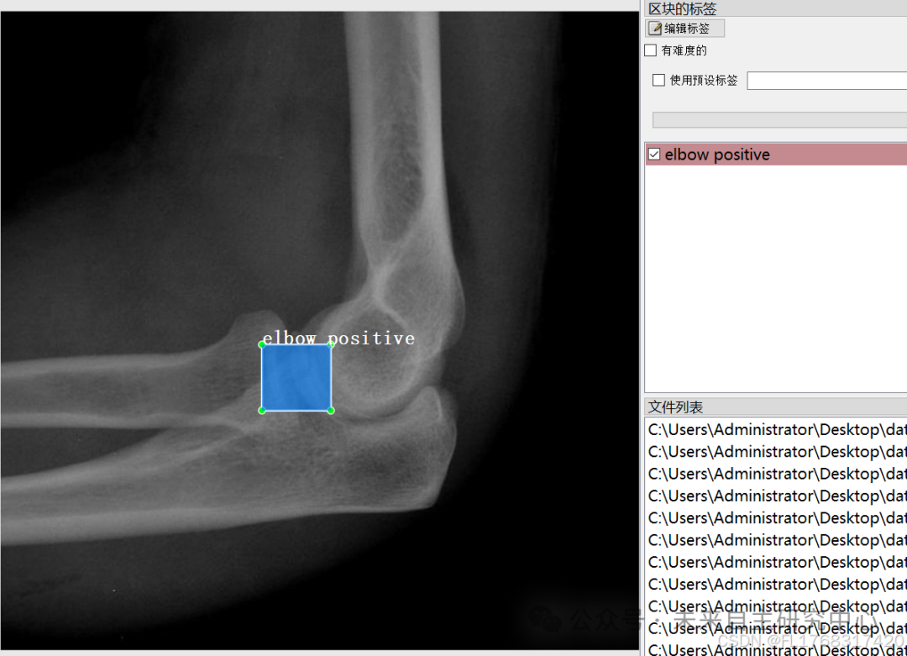

# Dataset for Fracture Detection in VOC+YOLO format with 2060 images across 7 classes

Dataset format: Pascal VOC format + YOLO format (txt files without split paths, only containing jpg images and corresponding VOC format xml files and yolo format txt files)
Number of images (jpg file count): 2060
Number of annotations (xml file count): 2060
Number of annotations (txt file count): 2060
Number of annotation categories: 7
Annotation category names: ["elbow positive", "fingers positive", "forearm fracture", "humerus", "humerus fracture", "shoulder fracture", "wrist positive"]
Number of boxes per category:
Elbow positive boxes = 385
Fingers positive boxes = 606
Forearm fracture boxes = 373
Humerus boxes = 362
Humerus fracture boxes = 3
Shoulder fracture boxes = 397
Wrist positive boxes = 262
Total boxes: 2388
Labeling tool used: labelImg
Annotation rules: Draw a box around the category
Important note: No guarantee is made regarding the accuracy or weights of the trained model. The dataset provides accurate and reasonable annotations only.

Image Preview:

Annotation example:

## Payment

Here is a pay link on Stripe ( https://buy.stripe.com/3cs8yP7sY87d0vu9AB ). Please contact me lonlonago@foxmail.com after funding $89, and I will send you a complete data files , thank you!

